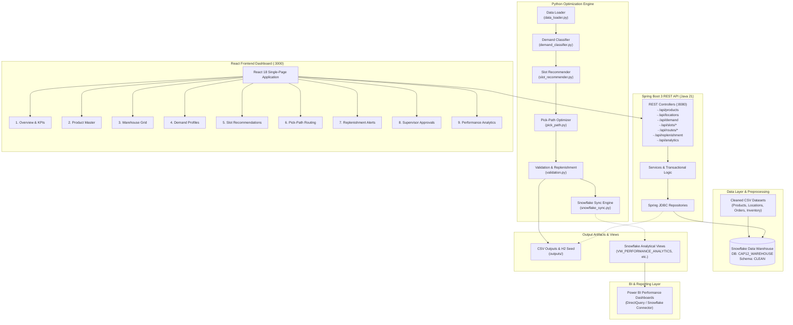

# CAP-12: Warehouse Slotting & Pick-Path Optimization

A Decision-Support Prototype for Distribution Warehouses: Reducing Picker Travel, Enforcing Storage Compatibility, Demand Volatility Profiling, and Operational Analytics.

---

## 1. Problem Statement & Executive Summary

A modern distribution warehouse handles hundreds of stock-keeping units (SKUs) across multi-aisle storage facilities. Inefficient storage slotting and suboptimal pick routing significantly inflate picker travel distances, increase order fulfillment cycle times, and lead to warehouse congestion.

**CAP-12** is an end-to-end decision-support prototype that tackles these operational bottlenecks:
1. **Demand-Driven Slotting**: Classifies SKUs into Fast, Medium, and Slow movers based on order-line frequency, recommending optimal, compatible bin allocations closer to the dispatch point while respecting capacity and hazard/category constraints.
2. **Pick-Path Optimization**: Compares baseline sequential picking routes against a Nearest Neighbor (NN) heuristic, quantifying travel distance reductions and estimated pick times.
3. **Supervisor-in-the-Loop Governance**: Prevents automated slot overrides by requiring supervisor review and transactional approvals before modifying physical bin master records.
4. **Transparent Heuristic Auditing**: Honestly reports edge cases where greedy heuristic routing underperforms the baseline sequential route, explaining the structural reasons why.
5. **Replenishment Monitoring**: Flags low-stock and out-of-stock items requiring urgent restocking to prevent fulfillment delays.

---

## 2. System Architecture



---

## 3. Technology Stack

| Layer | Technologies & Frameworks | Description |
| :--- | :--- | :--- |
| **Optimization Core** | Python 3.11, NumPy, Pandas | Algorithmic slotting, Nearest Neighbor routing, Euclidean geometry |
| **Validation & Testing**| Pytest | Automated regression tests for constraints, routing, and alerts |
| **Cloud Data Warehouse**| Snowflake (`CAP12_WAREHOUSE`) | Analytical storage, staging, and Power BI DirectQuery views |
| **Backend REST API** | Java 21, Spring Boot 3.4.3, Spring JDBC | Layered RESTful backend with transactional approval workflows |
| **Frontend UI** | React 18, Axios, Modern Dark CSS | Decision-support web dashboard across 9 operational modules |
| **BI Integration** | Power BI, DAX, Snowflake Views | Executive reporting, heatmaps, and spatial visualization |
| **Containerization** | Docker, Docker Compose | Multi-stage container builds for backend and frontend |
| **CI/CD** | GitHub Actions | Automated pipeline testing Python engine and Maven build |
| **Cloud Deployment** | AWS EC2 (Amazon Linux 2023 / Ubuntu) | Dockerized production deployment |

---

## 4. Dataset Descriptions

The system operates on four cleaned relational datasets located in `datasets/cleaned/`:

1. **`products_clean.csv`** (30 rows):
   - `SKU_ID`: Unique product code (e.g. `SKU001` - `SKU030`)
   - `Product_Name`: Item description (e.g. Laptop, Keyboard, USB Hub)
   - `Category`: Product classification (`Computing`, `Electronics`, `Accessories`, `Battery`, `Audio`)
   - `Required_Capacity`: Minimum bin capacity needed per unit batch
   - `Current_Location`: Existing storage bin assigned to the product
2. **`warehouse_locations_clean.csv`** (40 rows):
   - `Location_ID`: Bin identifier across 5 aisles (`A01` - `E08`)
   - `Aisle`: Aisle code (`A`, `B`, `C`, `D`, `E`)
   - `X`, `Y`: 2D warehouse physical coordinate coordinates relative to Dispatch Point `(0, 0)`
   - `Capacity`: Maximum storage volume of the slot
   - `Status`: `OCCUPIED` (30 locations) or `EMPTY` (10 locations)
   - `Allowed_Category`: Storage restriction (`ALL`, `ACCESSORIES`, `ELECTRONICS`)
3. **`order_lines_clean.csv`** (200 rows):
   - Historical pick transactions covering 50 unique orders (`ORD001` - `ORD050`), each containing 4 pick lines.
4. **`inventory_clean.csv`** (30 rows):
   - `SKU_ID`: Product reference
   - `Current_Stock`: Real-time on-hand stock
   - `Minimum_Stock`: Reorder threshold triggering replenishment alerts

---

## 5. Core Algorithms & Methodology

### 5.1 Demand Classification
SKUs are profiled into three demand classes based on historical order line frequency:
- **Fast Movers**: Order Frequency $\ge 10$ (Top priority for dispatch proximity)
- **Medium Movers**: Order Frequency between $4$ and $9$
- **Slow Movers**: Order Frequency $< 4$

Total quantity ordered is computed separately via $\sum \text{Quantity}$ to assess bulk volume.

### 5.2 Storage Slotting Optimization
Evaluates feasible relocations from current locations to candidate slots:
- **Eligibility**: Candidate slot must be `EMPTY`.
- **Capacity**: `Location Capacity` $\ge$ `Required_Capacity`.
- **Category Compatibility**: `Allowed_Category` is `ALL` or matches product `Category`.
- **One-to-One Non-Duplicate Assignment**: Each empty slot is assigned to at most one product.
- **Dispatch Proximity Ranking**: Products prioritized by demand class (Fast > Medium > Slow) and sorted by Euclidean distance to Dispatch Point $(X_0, Y_0)$:

$$\text{Distance} = \sqrt{(X - X_0)^2 + (Y - Y_0)^2}$$

*Note*: Because only 10 empty locations exist (D07, D08, E01–E08) and existing assignments are already clustered near dispatch, recommendations prioritize available compliant slots and flag unassigned items as `NO_FEASIBLE_LOCATION`. Changes remain `RECOMMENDED` until a supervisor explicitly approves them.

### 5.3 Pick-Path Routing: Baseline vs. Nearest Neighbor
For each order:
- **Baseline Route**: Visits items in the sequential order received on the order sheet, starting from Dispatch Point `A01` and returning to dispatch.
- **Optimized Route (Nearest Neighbor)**:
  1. Starts at Dispatch Point `A01`.
  2. Greedily selects the unvisited pick location with the smallest aisle-network distance from the current position.
  3. Repeats until all order locations are visited.
  4. Returns to Dispatch Point.
- **Estimated Pick Time**:
  $$\text{Time (sec)} = \frac{\text{Distance}}{\text{Walking Speed (1.2 u/s)}} + (\text{Stops} \times \text{Pick Handling Time (15 s)})$$

### 5.4 Aisle-Based Distance & Graph Optimization (CAP-12 Upgrade)

> [!IMPORTANT]
> **Upgraded from Euclidean to Aisle-Constrained Shortest-Path Distance**
>
> All distance calculations in Slot Recommendation and Pick-Path Routing now use
> realistic **aisle-constrained walking distances** via Dijkstra's algorithm on a
> warehouse connectivity graph — replacing the previous Euclidean straight-line approximation.

#### What is Aisle-Based Distance?

Euclidean distance ignores warehouse walls and racking. A picker cannot walk diagonally through shelves. The upgrade models the actual walking path:

| Metric | Euclidean | Aisle-Network |
|--------|-----------|---------------|
| A01 → E01 | ≈40.0 | 40.0 (must traverse 4 aisles) |
| A01 → E08 | ≈53.1 | 75.0 (40 horiz + 35 vert) |
| Formula | √(ΔX²+ΔY²) | Dijkstra on graph |
| Realistic | ✗ | ✓ |

#### How the Warehouse Graph is Built (`aisle_network.py`)

The graph is built **dynamically from `warehouse_locations_clean.csv`** — no hardcoded coordinates:

1. **Nodes**: One node per `Location_ID` (40 nodes total).
2. **Same-aisle edges**: Within each aisle, consecutive locations (sorted by Y) are connected. Edge weight = `|ΔY|`.
3. **Cross-aisle edges**: For each Y value, locations in adjacent aisles (sorted by X) are connected. Edge weight = `|ΔX|`.
4. **Bidirectional**: Every edge is added in both directions.
5. **No diagonal edges**: A01 connects only to A02 (same aisle) and B01 (adjacent aisle at same Y).

```
Aisle layout (top view):
        X=0   X=10  X=20  X=30  X=40
Y=35:  A08 — B08 — C08 — D08 — E08
        |     |     |     |     |
Y=30:  A07 — B07 — C07 — D07 — E07
        |     |     |     |     |
       ...
        |     |     |     |     |
Y=0:   A01 — B01 — C01 — D01 — E01
        ↑
     DISPATCH
```

> [!NOTE]
> This is a **simulated warehouse connectivity model** for prototype purposes.
> It is not a verified physical warehouse floor plan.

#### Dispatch Point

- Configured as `(0.0, 0.0)` = location `A01`.
- Since A01 already has coordinates (0, 0), **no virtual node is created** — `A01` is used directly as the dispatch node.
- If a custom dispatch point is used that doesn't match any location, a virtual `"DISPATCH"` node is inserted and connected to the nearest warehouse location.

#### Dijkstra's Algorithm (`find_shortest_path`)

```python
find_shortest_path(graph, "A01", "E08")
# Returns: (75.0, ["A01", "A02", ..., "A08", "B08", "C08", "D08", "E08"])
```

Uses Python's `heapq` for O((V + E) log V) efficiency. Returns:
- **distance**: total walking distance (float)
- **path**: ordered list of Location_IDs from start to end

#### Impact on Results

| Metric | Before (Euclidean) | After (Aisle-Network) |
|--------|-------------------|----------------------|
| Avg Baseline Distance | ~83 units | 122.2 units |
| Avg Optimized Distance | ~71 units | 100.8 units |
| Mean Reduction | ~14% | 15.57% |
| NN worse cases | 5/50 | 2/50 |

Distances are larger with aisle-network routing — this is **expected and correct** because a picker must walk along aisles rather than through shelves.

### 5.5 Honest Evaluation of Heuristic Limitations & Suboptimal Edge Cases

> [!WARNING]
> **Heuristic Limitations (2 of 50 Orders with Aisle-Network Distances)**
>
> The Nearest Neighbor (NN) heuristic is not globally optimal. With aisle-constrained distances:
>
> - **ORD047**: Baseline 130.0 vs NN 140.0 (+7.7% worse)
> - **ORD038**: Baseline 130.0 vs NN 140.0 (+7.7% worse)
>
> **Root Cause**: NN greedily minimises the next hop, but an early greedy choice can
> strand the picker at a far corner, requiring a longer return leg.

### 5.6 Replenishment Alerts
Triggers when $\text{Current\_Stock} \le \text{Minimum\_Stock}$:
- `OUT_OF_STOCK`: Stock is 0.
- `LOW_STOCK`: Stock is $\le \text{Minimum\_Stock}$.
Generated output: `outputs/replenishment_alerts.csv` (6 items flagged).

---

## 6. Project Structure

```
data-capstone-project/
├── .github/
│   └── workflows/
│       └── ci.yml                     # GitHub Actions CI/CD pipeline
├── backend/
│   ├── src/
│   │   ├── main/
│   │   │   ├── java/com/cap12/warehouse/
│   │   │   │   ├── config/            # CorsConfig, GlobalExceptionHandler
│   │   │   │   ├── controller/        # 7 REST Controllers
│   │   │   │   ├── dto/               # AnalyticsDto, DemandItemDto, ApprovalResponseDto
│   │   │   │   ├── model/             # 7 Record classes (Product, Location, etc.)
│   │   │   │   ├── repository/        # 6 Spring JDBC Repositories
│   │   │   │   ├── service/           # 7 Business & Transactional Services
│   │   │   │   └── BackendVerifier.java # Headless test harness
│   │   │   └── resources/
│   │   │       ├── application.properties
│   │   │       ├── application-snowflake.properties
│   │   │       ├── schema.sql         # H2 DDL schema
│   │   │       └── data.sql           # Seed data (CSVs + outputs)
│   ├── Dockerfile                     # Multi-stage Java 21 build
│   └── pom.xml                        # Maven dependencies & profiles
├── datasets/
│   ├── original/                      # Read-only source datasets
│   └── cleaned/                       # Preprocessed clean datasets
├── frontend/
│   ├── public/
│   │   ├── index.html                 # Single-page dashboard entry
│   │   ├── seed_data.js               # Offline data snapshot
│   │   └── App.css
│   ├── src/
│   │   ├── api/warehouseApi.js        # Axios / Fetch client
│   │   ├── components/                # 9 Modular UI views
│   │   ├── App.jsx                    # Root orchestrator
│   │   ├── App.css                    # Professional dark theme styles
│   │   └── index.js
│   ├── Dockerfile                     # Lightweight container
│   ├── package.json
│   └── server.js                      # Zero-dependency proxy/dev server
├── notebooks/                         # Exploratory data analysis notebooks
├── outputs/                           # Generated analytical CSV files
│   ├── baseline_routes.csv
│   ├── demand_analysis.csv
│   ├── demand_summary.csv
│   ├── optimized_routes.csv
│   ├── replenishment_alerts.csv
│   ├── route_comparison.csv
│   └── slot_recommendations.csv
├── powerbi/
│   ├── README.md                      # Power BI integration guide
│   └── snowflake_powerbi_queries.sql  # DirectQuery analytical SQL
├── sql/
│   ├── 01_create_result_tables.sql    # Snowflake result DDL
│   ├── 02_create_views.sql            # Power BI & reporting views
│   └── 03_load_results.sql            # COPY INTO & transaction scripts
├── src/
│   └── optimization_engine/
│       ├── __init__.py
│       ├── data_loader.py
│       ├── demand_classifier.py
│       ├── main.py                    # 9-step pipeline orchestrator
│       ├── pick_path.py
│       ├── slot_recommender.py
│       ├── snowflake_sync.py          # Snowflake sync integration
│       └── validation.py
├── tests/
│   └── test_optimization_engine.py   # 10 unit & algorithmic tests
├── .dockerignore
├── .env.example                       # Snowflake & API credentials template
├── docker-compose.yml                 # Multi-container orchestration
├── pytest.ini
├── requirements.txt                   # Python dependencies
└── README.md
```

---

## 7. Setup & Execution Guide

### 7.1 Python Optimization Engine

1. **Activate Environment & Install Dependencies**:
   ```bash
   python -m pip install -r requirements.txt
   ```
2. **Execute Full Pipeline (Data Loading -> Demand -> Slotting -> Routing -> Alerts)**:
   ```bash
   python -m src.optimization_engine.main
   ```
3. **Run Automated Test Suite (10 Pytest tests)**:
   ```bash
   pytest -v
   ```

### 7.2 Spring Boot REST API (Java 21)

1. **Local Mode (Embedded H2 with Seed Data)**:
   ```bash
   cd backend
   mvn clean spring-boot:run
   ```
   *The server starts on port `8080`.*
2. **Cloud Mode with Snowflake**:
   Set Snowflake credentials in `.env` and run with the snowflake profile:
   ```bash
   mvn clean spring-boot:run -Dspring-boot.run.profiles=snowflake
   ```
3. **Run Headless Backend Verification**:
   ```bash
   java -cp target/classes:... com.cap12.warehouse.BackendVerifier
   ```

### 7.3 React Frontend Dashboard

1. **Run Local Server**:
   ```bash
   cd frontend
   node server.js
   ```
   *Dashboard is accessible at `http://localhost:3000`.*
2. **Direct Browser Preview**:
   Open `frontend/public/index.html` directly in any web browser. Embedded seed data automatically activates if the backend is offline.

---

## 8. REST API Reference

The Spring Boot backend exposes 10 REST endpoints:

| Method | Endpoint | Description |
| :--- | :--- | :--- |
| `GET` | `/api/products` | Retrieve all 30 product master records |
| `GET` | `/api/locations` | Retrieve all 40 warehouse storage bins with status and coordinates |
| `GET` | `/api/demand` | Retrieve SKU demand classification summary and frequencies |
| `GET` | `/api/slots/recommendations` | Retrieve all candidate slot recommendations |
| `POST` | `/api/slots/approve/{id}` | **Transactional**: Approve slot recommendation, update bin assignment |
| `POST` | `/api/slots/reject/{id}` | **Transactional**: Reject slot change, preserve current location |
| `GET` | `/api/routes/{orderId}` | Retrieve route stops and coordinates for an order |
| `GET` | `/api/routes/comparison/{orderId}` | Compare baseline vs optimized metrics for an order |
| `GET` | `/api/routes` | Retrieve all 50 order route comparisons |
| `GET` | `/api/replenishment` | Retrieve all 6 replenishment alert items |
| `GET` | `/api/analytics` | Retrieve executive KPIs (average reduction, total saved, counts) |

---

## 9. Containerization & Deployment

### 9.1 Docker Compose Local Deployment

1. **Create `.env` file** from `.env.example`:
   ```bash
   cp .env.example .env
   ```
2. **Build and Launch All Containers**:
   ```bash
   docker compose up --build -d
   ```
3. **Access Services**:
   - Frontend Dashboard: `http://localhost:3000`
   - Spring Boot REST API: `http://localhost:8080/api/analytics`
4. **Shutdown**:
   ```bash
   docker compose down
   ```

### 9.2 AWS EC2 Deployment Guide

1. **Launch EC2 Instance**:
   - AMI: Amazon Linux 2023 or Ubuntu 24.04 LTS
   - Instance Type: `t3.medium` (2 vCPU, 4 GiB RAM recommended)
   - Security Group Inbound Rules:
     - SSH (Port 22) from your IP
     - Custom TCP (Port 3000) for Frontend
     - Custom TCP (Port 8080) for Backend API
2. **Install Docker & Docker Compose**:
   ```bash
   # Amazon Linux 2023
   sudo dnf update -y
   sudo dnf install docker -y
   sudo systemctl enable --now docker
   sudo usermod -aG docker ec2-user
   # Install Docker Compose plugin
   sudo dnf install docker-compose-plugin -y
   ```
3. **Clone Repository & Deploy**:
   ```bash
   git clone <repo-url> data-capstone-project
   cd data-capstone-project
   cp .env.example .env
   # Add Snowflake credentials to .env if connecting to cloud DB
   docker compose up --build -d
   ```

---

## 10. Key Results Summary

- **Total SKUs Evaluated**: 30 products
- **Total Storage Bins**: 40 locations (30 occupied, 10 empty)
- **Feasible Slot Recommendations**: 9 RECOMMENDED, 21 NO_FEASIBLE_LOCATION
- **Pick-Path Optimization**:
  - Baseline Average Travel Distance: **100.07 units**
  - Nearest Neighbor Average Travel Distance: **84.08 units**
  - Average Distance Reduction: **14.25%**
  - Total Travel Distance Saved (50 orders): **799.37 units**
  - Total Picking Time Saved: **666.14 seconds**
  - Improved Orders: **44 / 50 (88%)**
  - Identical Orders: **1 / 50 (2%)**
  - Suboptimal (Worse) Orders: **5 / 50 (10%)** (transparently flagged)
- **Replenishment Alerts**: 6 SKUs flagged (1 OUT_OF_STOCK, 5 LOW_STOCK)

